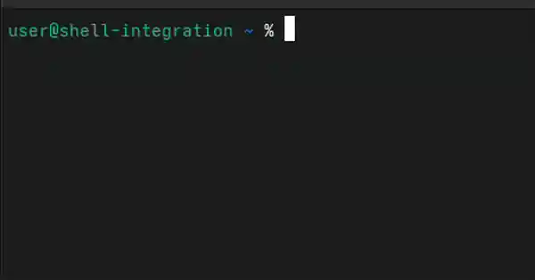

<div align="center">
<h1>terminal-aichat</h1>
</div>


<div align="center"></div>
<div align="center"></div>

[README中文](./README_zh.md)

A CLI for AI/LLM chat in terminal
- written in rust, light (6.5MB binary size), super fast.
- multi platform(Windows, Linux, MacOS)
- using `/v1/chat/completion` API


```sh
aichat <INPUT MESSAGE>
```


## Quick Start

### Installation


#### sh
```sh
curl --proto '=https' --tlsv1.2 -LsSf https://github.com/ctxinf/terminal-aichat/releases/latest/download/terminal-aichat-installer.sh | sh
```

#### cargo
```sh
cargo install terminal-aichat
```

#### homebrew
```sh
brew install ctxinf/tap/terminal-aichat
```

#### ~~npm~~
>Deprecated, but you can still install version 0.3.5 with it

```sh
npm install terminal-aichat@latest
```

#### powershell
```sh
powershell -ExecutionPolicy Bypass -c "irm https://github.com/ctxinf/terminal-aichat/releases/latest/download/terminal-aichat-installer.ps1 | iex"
```

#### binary
or download executable binaries directly in [Release](https://github.com/ctxinf/terminal-aichat/releases) page.

### Prerequisites

Edit the config file to setup providers and models:

```sh
# First, get the config file location
aichat --list
# Or just:
aichat

# Then edit the config file (example for Linux)
nano ~/.config/terminal-aichat/config.jsonc
```

The config file contains a commented-out example that you can uncomment and modify.

### Chat

```sh
# Directly send a message
aichat how to view ubuntu release version

# If your message conflicts with an option, wrap it with quotes
aichat "how to use --config option"

# other ways
aichat "<INPUT MESSAGE>"
aichat -- <INPUT MESSAGE>

# pipe
cat input.txt | aichat
cat input.txt | aichat "explain this"

# pure mode (display for model/prompts configs and costs will be hide)
aichat --pure "Hello?"
```

### Shell Integration (`?` / `?!`)

One-line install adds two commands to your shell:

```sh
# zsh
eval "$(aichat --init-integration zsh)"
# bash
eval "$(aichat --init-integration bash)"
# fish
aichat --init-integration fish | source
```

| Command | Behavior |
| --- | --- |
| `? <message>` | Ask AI; if reply is a runnable command, **pre-fill it in the buffer** (you press Enter). Otherwise dump the reply between `###` markers. |
| `?! <message>` | Same, but **auto-execute** the parsed command. Each line is echoed as `# …` (dimmed) first, so you see what's running. |
| `cmd \| ? "..."` | Pipe stdin in as extra context. |
| `? --debug ...` | Also prepend the raw model reply as a comment (`?` only). |

The integration prompt is written to your config as `prompts.shell-exec-or-chat` — **read it, edit it, swap it out** with `--prompt <name>`. Bash/fish use `q` / `qe` as the canonical names (the `?` / `?!` aliases are best-effort).

## Configuration

### View Configurations

```sh
aichat --list
# or
aichat -l
```

This will show all configured providers, models, prompts, and the config file location.

### Edit Configuration

Configuration is done by directly editing the config file (JSONC format with comments support).

Config file locations (cross-platform):
- Linux: `~/.config/terminal-aichat/config.jsonc`
- macOS: `~/Library/Application Support/terminal-aichat/config.jsonc`
- Windows: `%APPDATA%\terminal-aichat\config.jsonc`

The config file uses JSONC format, which supports comments. A complete example is provided in the default config file.

Example config structure:
```jsonc
{
  "defaultProvider": "openai",
  "defaultModel": "gpt-5-mini",
  "defaultPrompt": "concise",
  "defaultThinkingLevel": "low",
  "providers": {
    "openai": {
      "baseUrl": "https://api.openai.com/v1",
      "apiKey": "$MY_OPENAI_API_KEY",
      "models": [
        { "id": "gpt-5-mini" },
        {
          "id": "custom-model",
          "name": "My model",
          "reasoning": false,
          "extraBody": { "temperature": 0.7 },
          "removeBodyFields": ["store"]
        }
      ]
    },
    "local": {
      "baseUrl": "http://127.0.0.1:11434/v1",
      "models": [{ "id": "local-model" }]
    }
  },
  "auth": {
    // Optional fallback when MY_OPENAI_API_KEY is unset.
    // Encrypted values use a matching generated encryption passphrase.
    // "openai-account": { "key": "MY_OPENAI_API_KEY", "value": "your-key" }
  },
  "prompts": {
    "concise": { "system": "Use plain text, give concise output." }
  }
}
```

### Specify a Model

```sh
# Use a specific model selector (searches all providers)
# - model ID: "gpt-4o"
# - or provider/model-id: "openrouter/meta-llama/llama-3-70b-instruct"
aichat --model gpt-4o "Hello?"

# Or short form
aichat -m gpt-5-mini "Hello?"

# When model IDs conflict across providers, or when model IDs contain '/',
# use provider/model-id to disambiguate:
aichat -m openrouter/meta-llama/llama-3-70b-instruct "Hello?"
```

### Specify a Prompt

```sh
# Use a specific prompt
aichat --prompt concise "Hello?"

# Or short form
aichat -p sample_prompt "Hello?"
```

Prompts support separate `system` and `user` templates:

```jsonc
"prompts": {
  "context": {
    "system": "You are a terminal assistant. Directory: {{ cwd }}\nOS: {{ shell(\"cat /etc/os-release\") }}",
    "user": "Please answer: {{ input }}"
  }
}
```

Supported expressions are `{{ input }}`, `{{ cwd }}`, `{{ env("LANG") }}`,
and `{{ shell("command -v git") }}`. Omitting `user` sends the original input.
Functions accept one JSON string argument; escape its quotes in JSON configuration.
`shell()` inserts stdout and supports pipes, redirection, and `$()`, such as
`{{ shell("printf '%s' \"$(command -v git)\"") }}`.
Only these explicit expressions are supported, without Jinja loops, conditions, or filters.

Templates run once before each request; retries reuse the rendered result.
Listing configuration and help never execute commands. Inserted input, environment
values, and command output are never parsed again. Commands run in the current
directory using `/bin/sh -c` on Unix or `cmd /D /S /C` on Windows.
Commands have a 3-second timeout and a combined 64 KiB stdout/stderr limit.
Nonzero exits, timeouts, excessive output, and non-UTF-8 stdout abort the request.
Only trailing line endings are removed from stdout; stderr is used for failure
diagnostics. On Unix, cleanup kills the entire command process group.
A hardcoded blacklist rejects common mutation commands, interpreters, and file-writing
redirection before execution. It is conservative and can also reject these words
as arguments. Git is limited to path lookup and `--version`. This guardrail is
not a shell sandbox; use trusted commands in local configuration.

Legacy `content` remains a literal system message and cannot be combined with
`system`. Usually put context in `system` and `input` in `user` to avoid duplication.

### Use Custom Config File

```sh
# Specify a custom config file path
aichat --config /path/to/config.jsonc --list
aichat --config /path/to/config.jsonc "Hello?"
```

### Model schema and request options

Models are arrays of objects with required `id` (the request model) and optional
`name` (display name). `defaultProvider` scopes bare model IDs/names; an explicit
`provider/model-id` selects another provider. Without a default provider, IDs
are searched globally and ambiguous matches are errors. IDs take precedence over names.

`reasoning` defaults to true. `thinkingLevel` overrides `defaultThinkingLevel`
(default `low`) and is sent directly as `reasoning_effort`. Set `reasoning: false`
to omit it. Provider `extraBody` fields override the generated request, model
`extraBody` fields override provider fields, and `removeBodyFields` removes
specified top-level fields last. Merging is shallow; nested values are replaced.
Put API-specific fields such as `temperature` in `extraBody`.

Provider options: `api` (only `openai-completions`, the default), `headers`,
`queryParams`, `timeoutMs` (120000), `maxRetries` (2), and `extraBody`.
Model `headers` override provider headers, case insensitively; custom headers
override generated authentication. Headers accept `$NAME` / `${NAME}` interpolation
and explicit `!command` values. Commands run only for the selected model on request,
time out after 10 seconds, and successful results are cached in the process.
Use command headers only in trusted configuration.

### API credentials

Provider `apiKey` accepts a literal string or a whole `$NAME` / `${NAME}` reference.
A reference first reads that environment variable; if unset, it finds the top-level
`auth` entry whose `key` equals `NAME`. Auth entries allow only `key`, `value`,
and `encryption` strings. `value` is literal unless `encryption` is present;
then it must be a v1 encrypted packet (AES-256-GCM with Argon2id).
Neither field interpolates variables or runs commands. An empty/invalid environment
credential or a decryption failure is an error. No implicit `OPENAI_API_KEY` lookup
or environment-file loading occurs. Omit `apiKey` for unauthenticated services
(or use `"auth": {"type": "none"}`).

```sh
export MY_OPENAI_API_KEY=your-key
aichat "Hello?"
```

### Set Log Level

```sh
export LOG_LEVEL=DEBUG
```

> Equivalent to using `--verbose`

### Pure Mode (`--pure`)

> Suppresses all extra messages and outputs only the response.

```sh
aichat --pure "Hello?"
```

### Verbose Logging (`--verbose`)

```sh
aichat --verbose "Hello?"
```

### Disable Streaming Mode (`--disable-stream`)

```sh
aichat --disable-stream "Hello?"
```
